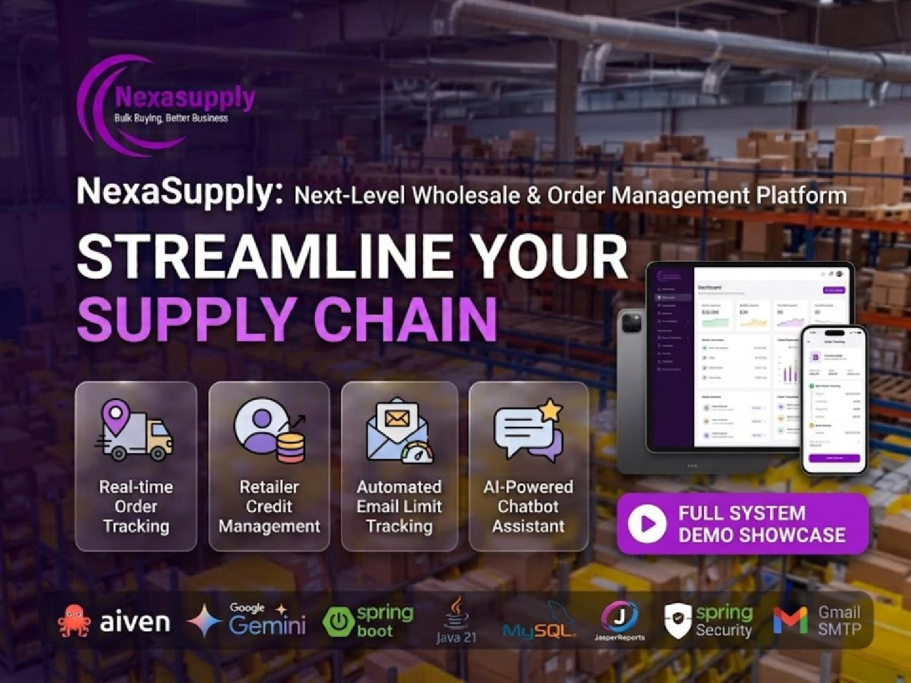
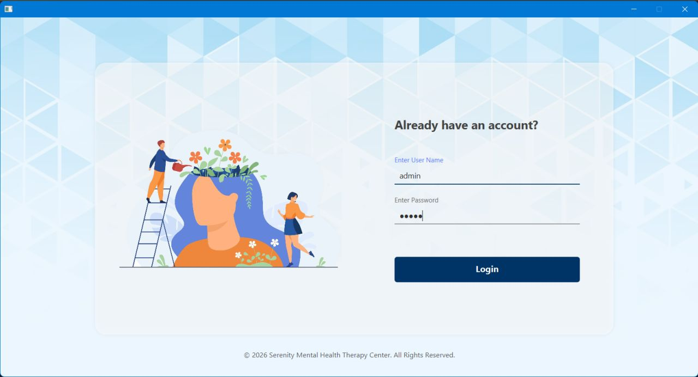
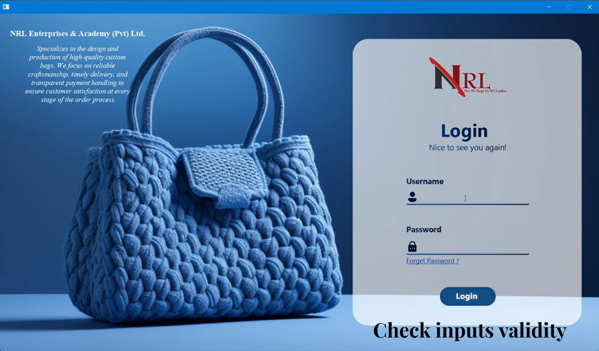

<!-- ═══════════════ HERO (glass panel, animated) ═══════════════ -->
<p align="center">
  
</p>

<p align="center">
  
  
  
  
</p>

<p align="center">
  A detail-oriented Software Engineering student who loves clean code, solid architecture and real-world problem solving.<br/>
  I build systems that replace manual workflows with fast, secure and well-structured software.
</p>

<p align="center">
  <a href="https://induni-palliyaguru.vercel.app/" target="_blank"></a>
  <a href="https://www.linkedin.com/in/induni-palliyaguru-6195a9371" target="_blank"></a>
  <a href="https://mail.google.com/mail/?view=cm&fs=1&to=lakmiindu11@gmail.com" target="_blank"></a>
</p>

<p align="center">
  
</p>

<!-- ═══════════════ ABOUT ═══════════════ -->
<p align="center">
  
</p>

```java
public class Induni implements SoftwareEngineer {

    String education = "Higher Diploma in Software Engineering @ IJSE";
    String[] focus   = { "Advanced API Development",
                         "Enterprise Architecture (DAO / BO)",
                         "Hibernate ORM & Spring Data JPA",
                         "Spring Boot & Spring Security" };
    String goal      = "Software Engineer / Systems Architect";

    public void philosophy() {
        // Complex business logic + proper design patterns
        // + a well-optimized relational model = great software
    }
}
```

<p align="center">
  
</p>

<!-- ═══════════════ TECH STACK ═══════════════ -->
<p align="center">
  
</p>

<table align="center" width="100%">
  <tr>
    <td align="center" width="25%"><b>⚙️ Backend</b></td>
    <td align="center" width="25%"><b>🎨 Frontend</b></td>
    <td align="center" width="25%"><b>🗄️ Database</b></td>
    <td align="center" width="25%"><b>🧰 Tools</b></td>
  </tr>
  <tr>
    <td align="center"></td>
    <td align="center"></td>
    <td align="center"></td>
    <td align="center"></td>
  </tr>
</table>

<p align="center">
  
  
  
  
  
  
  
  
  
</p>

<p align="center">
  
</p>

<!-- ═══════════════ PROJECTS ═══════════════ -->
<p align="center">
  
</p>

<!-- ───── NEXASUPPLY ───── -->
<h3 align="center">📦 NexaSupply &nbsp;</h3>

<table width="100%">
  <tr>
    <td width="46%" valign="middle" align="center">
      <a href="https://lnkd.in/gcHZ38Zs">
        
      </a>
    </td>
    <td width="54%" valign="top">
      <b>Next-Level B2B Wholesale &amp; Order Management Platform</b>
      <p>A production-grade wholesale distribution platform (ITS1114 – Advanced API Development module) built to digitize manual workflows, optimize stock tracking and secure financial management for distributors and retailers.</p>
      <p>
        
        
        
        
        
        
        
      </p>
      <ul>
        <li>🤖 <b>AI chatbot (Google Gemini)</b> answering only NexaSupply queries, with strict Admin vs Retailer data visibility</li>
        <li>💳 <b>Credit limit enforcement</b> at checkout with automated deductions, restorations and immutable ledgers</li>
        <li>📦 <b>Order &amp; shipment tracking</b>: Pending → Approved → Dispatched → Delivered, with driver assignment</li>
        <li>📑 <b>Dynamic PDF invoices</b> (JasperReports 7.0.3) and automated emails via Gmail SMTP</li>
      </ul>
      <details>
        <summary><b>🔎 More details</b></summary>
        <br/>
        <ul>
          <li>☁️ Aiven Cloud MySQL over encrypted SSL (16 normalized entities)</li>
          <li>🔐 JWT authentication with role-based access control (RBAC)</li>
          <li>💻 RESTful modules: authentication, catalog, suppliers, inventory</li>
          <li>💰 Payment history, pending balances and ledger adjustments</li>
          <li>📈 Chart.js analytics dashboard with system audit logs</li>
          <li>🧱 Clean Layered Architecture, SLF4J / Logback logging, tested with Postman</li>
        </ul>
      </details>
      <a href="https://lnkd.in/gcHZ38Zs"></a>
      <a href="https://lnkd.in/gvVA9d3F"></a>
      <a href="https://lnkd.in/g5Dpi6-i"></a>
    </td>
  </tr>
</table>

<p align="center">
  
</p>

<!-- ───── SERENITY & NRL ───── -->
<table width="100%">
  <tr>
    <td width="50%" valign="top">
      <h3 align="center">🧠 Serenity Mental Health Care System</h3>
      <p align="center">
        
      </p>
      <p>An enterprise-level management solution that digitizes mental health care operations with a focus on performance and data visibility.</p>
      <p>
        
        
        
        
      </p>
      <ul>
        <li>Strict <b>Layered Architecture (DAO / BO)</b></li>
        <li><b>Hibernate 2nd Level Cache</b> to reduce latency</li>
        <li>Data modules with dynamic visibility controls for sensitive healthcare records</li>
      </ul>
      <p align="center">
        <a href="https://github.com/InduniPalliyaguru/Serenity-Mental-Health-Therapy-Center-System-ORM-Hibernate.git"></a>
      </p>
    </td>
    <td width="50%" valign="top">
      <h3 align="center">👜 NRL Bag Management System</h3>
      <p align="center">
        
      </p>
      <p>A standalone desktop app (Semester 1 final project) that digitizes and automates a small-scale bag manufacturing business.</p>
      <p>
        
        
        
        
      </p>
      <ul>
        <li>Replaced a notebook-based workflow with one digital system</li>
        <li>Customer registration, order tracking and material stock modules</li>
        <li>Payment handling for advances and pending balances</li>
        <li>Search and basic report generation</li>
      </ul>
      <p align="center">
        <a href="https://github.com/InduniPalliyaguru/NRL-Bag-System-Layered-Architecture.git"></a>
      </p>
    </td>
  </tr>
</table>

<p align="center">
  
</p>

<!-- ═══════════════ ARCHITECTURE ═══════════════ -->
<p align="center">
  
</p>

<table align="center">
  <tr>
    <td align="center"><b>🖥️ Client / UI</b><br/><sub>HTML · JS · JavaFX</sub></td>
    <td align="center">➡️</td>
    <td align="center"><b>🎛️ Controller</b><br/><sub>REST endpoints</sub></td>
    <td align="center">➡️</td>
    <td align="center"><b>🧠 Service / BO</b><br/><sub>Business logic</sub></td>
    <td align="center">➡️</td>
    <td align="center"><b>📚 Repository / DAO</b><br/><sub>JPA · Hibernate</sub></td>
    <td align="center">➡️</td>
    <td align="center"><b>🗄️ MySQL</b><br/><sub>Aiven Cloud</sub></td>
  </tr>
  <tr>
    <td></td>
    <td></td>
    <td align="center"><sub>🔐 Spring Security<br/>JWT · RBAC</sub></td>
    <td></td>
    <td align="center"><sub>🤖 Gemini API<br/>📑 JasperReports<br/>✉️ Gmail SMTP</sub></td>
    <td></td>
    <td></td>
    <td></td>
    <td></td>
  </tr>
</table>

<p align="center">
  
</p>

<!-- ═══════════════ FOCUS ═══════════════ -->
<p align="center">
  
</p>

<p align="center">
  
  
  
  
</p>

<p align="center">
  
</p>

<!-- ═══════════════ STATS ═══════════════ -->
<p align="center">
  
</p>

<table width="100%">
  <tr>
    <td width="50%" align="center">
      
    </td>
    <td width="50%" align="center">
      
    </td>
  </tr>
  <tr>
    <td width="50%" align="center">
      
    </td>
    <td width="50%" align="center">
      
    </td>
  </tr>
</table>

<p align="center">
  
</p>

<p align="center">
  
</p>

<!-- ═══════════════ SNAKE ═══════════════ -->
<p align="center">
  
</p>

<!-- Generated by the GitHub Action in .github/workflows/snake.yml -->
<p align="center">
  <picture>
    <source media="(prefers-color-scheme: dark)" srcset="https://raw.githubusercontent.com/InduniPalliyaguru/InduniPalliyaguru/output/github-contribution-grid-snake-dark.svg" />
    <source media="(prefers-color-scheme: light)" srcset="https://raw.githubusercontent.com/InduniPalliyaguru/InduniPalliyaguru/output/github-contribution-grid-snake.svg" />
    
  </picture>
</p>

<p align="center">
  
</p>

<!-- ═══════════════ FOOTER ═══════════════ -->
<p align="center">
  
</p>
